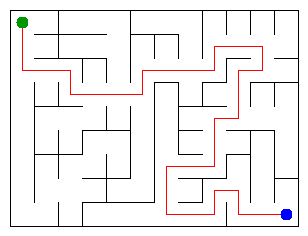

# Assignment 3. Maze Escape

Student ID: 250738
Name: Anas
Group: SE-2511
Maze size (rows x columns): 9 x 12

This file is the report. Fill it in as you go. How to start: `START_HERE.md`. The task: `docs/Assignment3.pdf`.

## Program output

The 13 lines your program prints on your data (`java -cp out Main`):

    Broken: 107
    Kept: 88
    Last broken wall: 163
    MST cost: 31967
    Heaviest broken wall: 705
    Path length: 33
    DFS visited: 71
    Dead ends: 36
    Zones: 108
    Largest zone: 1
    Is DAG: 1
    Flow stages: 15
    Fastest route cost: 42

My maze:

## Questions

Answer in your own words, two or three sentences each.

Mission 0. What do find and union do, and what makes them fast in your code?

- find(x) returns the representative root of the set containing x, while union(a, b) merges the two sets 
containing a and b if they are currently disjoint. 
They run in nearly O(1) (O(alpha(n))) amortized time because union attaches the smaller 
tree under the root of the larger tree (union by size, keeping tree height O(log n) and find
flattens the tree by pointing every visited node directly to the root (path compression).

Mission 1. Why is Broken always R*C - 1, and Kept always (R-1)*(C-1)?

- The maze has R * C cells, and each broken wall merges two separate groups of cells into one. 
To connect all R * C cells into a single connected component without cycles (a spanning tree), 
we always need to break exactly R * C - 1 walls. 
A grid of R rows and C columns has R * (C - 1) + (R - 1) * C = 2 * R * C - R - C inner walls in total, 
so subtracting the R * C - 1 broken walls leaves 
(2 * R * C - R - C) - (R * C - 1) = R * C - R - C + 1 = (R - 1) * (C - 1) walls that stay.

Mission 2. My MST cost from Kruskal and from Prim, and why they are equal:

- My MST cost from both Kruskal and Prim is 31967. 
They are equal because all wall costs in the file are different, 
which guarantees that the minimum spanning tree of the graph is unique, 
so both algorithms end up choosing the exact same set of walls.

Mission 3. Why is there exactly one path between two cells? How did you avoid a stack overflow on a huge maze?

- In Mission 1 we only break a wall when its two cells are in different sets, 
stopping once all n cells are connected by n - 1 open doors. 
A connected graph with n vertices and n - 1 edges is a tree, 
which has no cycles and therefore has a unique path between any two cells. 
To avoid a stack overflow on a 1000x1000 maze, 
I wrote DFS iteratively using an explicit ArrayDeque stack instead of recursion.

Mission 4. Why does the second pass of Kosaraju go on the reversed graph? Why do the slides have no cycle exactly when Zones equals the number of cells?

- The cell that finishes last in the first pass belongs to a source zone 
(a zone with no incoming slides from other zones), 
and reversing the slides flips all outgoing edges from this zone into incoming edges 
so the second DFS cannot leak into other zones. 
Since there is no slide from a cell to itself, 
any cycle must contain at least 2 cells that can reach each other and merge into one zone, 
so the slides have no cycle if and only if every cell stays in a zone of size 1 (Zones == n).

Mission 5. Why is it enough to go through the zones in the order of their numbers? What does this pass cost?

- The graph of zones has no cycles (it is a DAG), 
and the second pass of Kosaraju numbers the zones in topological order from 0 to Zones - 1, 
meaning every slide between two different zones goes from a smaller zone number X to a larger zone number Y. 
When we reach zone Y in the loop, all zones X that can reach Y have already been processed, 
so one pass in O(n + m) time and O(n + m) space is enough without a priority queue.

## AI use

Used Gemini to help write and refactor the mission implementations using standard Java collections 
(PriorityQueue, ArrayDeque, ArrayList), debug the iterative DFS and Kosaraju passes, 
and review the theory questions and complexity analysis.

## Timing (Mission 7)

Milliseconds, 5 runs each, from `java -cp out Bench`.

| maze        | Kruskal                            | Prim                               |
|-------------|------------------------------------|------------------------------------|
| 100 x 100   | 18 10 12 18 20  avg 16             | 19 16 7 6 5  avg 11                |
| 300 x 300   | 131 85 72 59 58  avg 81            | 72 67 60 60 68  avg 65             |
| 1000 x 1000 | 1465 1470 1425 1340 1257  avg 1392 | 1925 1772 1855 1764 1893  avg 1842 |

What do the numbers say about how the time grows? Two or three sentences.

As the maze grows from 100x100 (10,000 cells) to 300x300 (90,000 cells, 9x larger) 
and 1000x1000 (1,000,000 cells, 100x larger than 100x100), 
the average time grows from 16 ms to 81 ms to 1392 ms for Kruskal, 
and from 11 ms to 65 ms to 1842 ms for Prim. 
Between 300x300 and 1000x1000 (an 11.1x increase in cells and walls), 
Kruskal's time increases by about 17x and Prim's by about 28x, 
which matches their O(m log m) and O(m log n) growth 
plus slower memory access once the arrays exceed CPU cache. 
Prim is slightly faster on the smaller 100x100 and 300x300 mazes, 
but Kruskal becomes faster on the 1000x1000 maze (1392 ms vs 1842 ms) 
because Prim's priority queue has to allocate and heap-sift millions of edge entries.

## Complexity

n is the number of cells, m the number of walls (or slides). Fill in every algorithm you wrote.

| algorithm               | time                  | space    | assumptions                                        |
|-------------------------|-----------------------|----------|----------------------------------------------------|
| DSU find and union      | O(alpha(n)) amortized | O(n)     | union by size and path compression                 |
| Kruskal                 | O(m log m)            | O(n + m) | sorting m walls dominates DSU operations           |
| Prim                    | O(m log n)            | O(n + m) | binary heap priority queue and adjacency list      |
| DFS                     | O(n + m) = O(n)       | O(n)     | tree maze has m = n - 1 open doors                 |
| Kosaraju                | O(n + m)              | O(n + m) | two iterative DFS passes over n cells and m slides |
| Route in the zone graph | O(n + m)              | O(n + m) | zones are numbered in topological order            |

## Before you submit

- data/walls.txt, data/slides.txt and output/maze.png are in the repository.
- `java tools/Check.java` shows all examples right.
- This README is filled in, the program output and the section AI use included.
- The work is pushed to main (at least one commit per mission) and the repository is public.
- The link is attached in Moodle.
